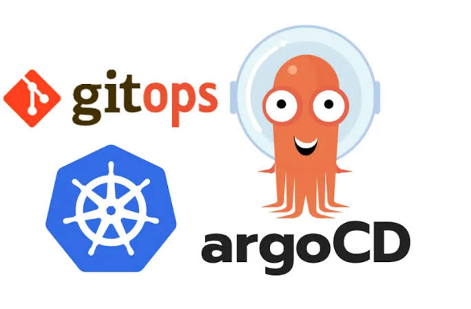
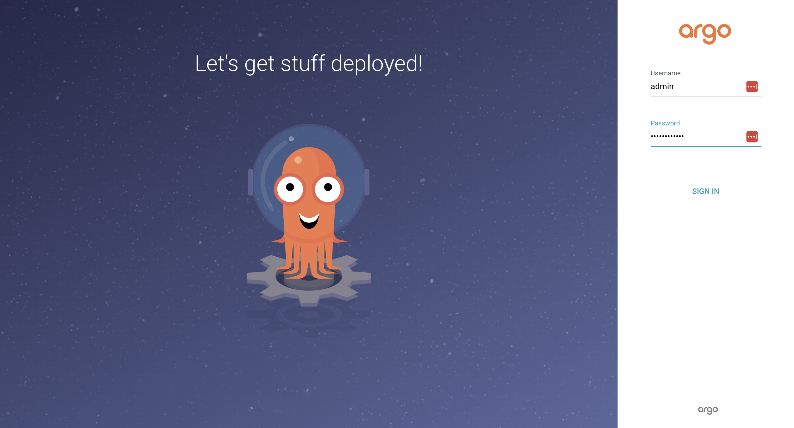
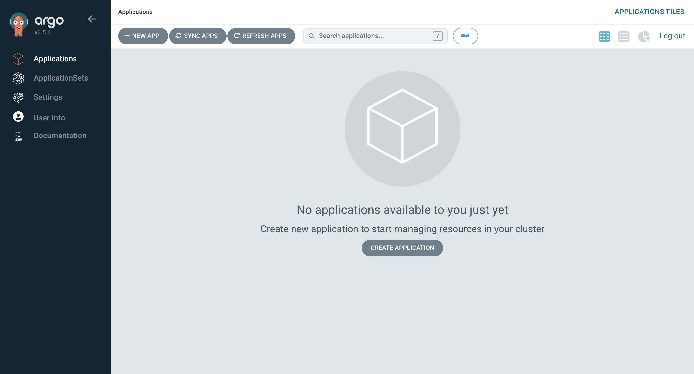
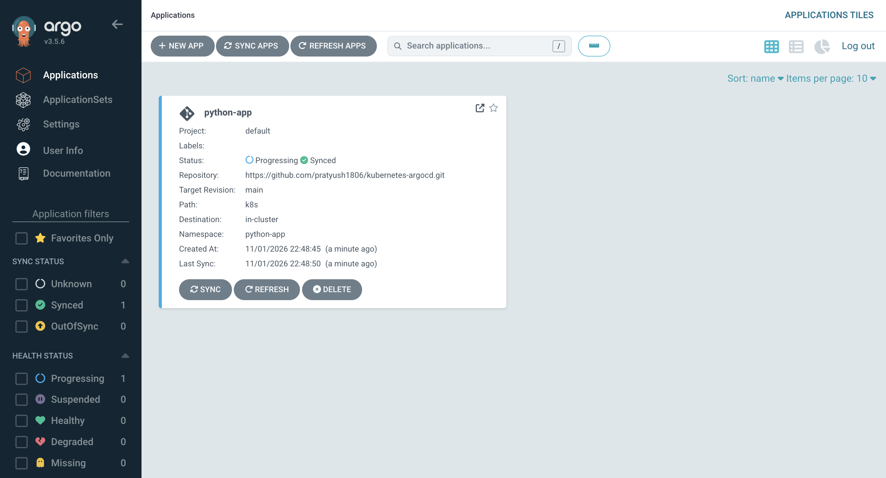
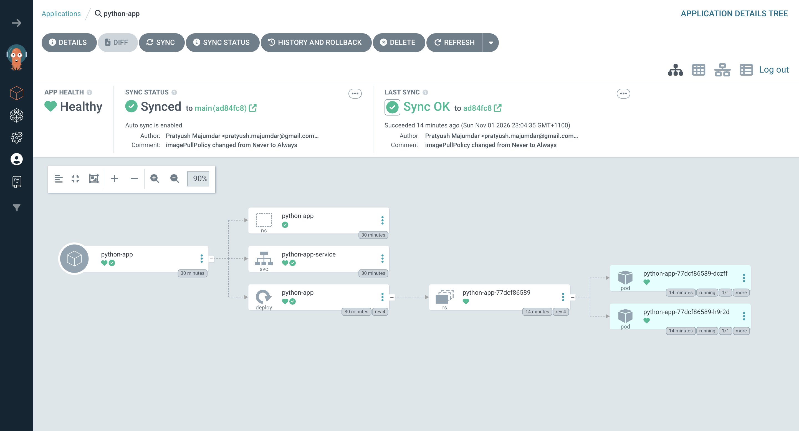

# Kubernetes Argo CD with GitOps
This tutorial walks through the installation and configuration of Argo CD on a Kubernetes cluster and demonstrates how to implement GitOps-based Continuous Delivery (CD).
Using a sample Python application, we will configure Argo CD to connect to a Git repository, monitor application manifests, and automatically synchronise the desired application state with the Kubernetes cluster.



### Install Argo CD
```
# create a namespace
kubectl create namespace argocd

# install argocd
kubectl apply -n argocd --server-side --force-conflicts -f https://raw.githubusercontent.com/argoproj/argo-cd/stable/manifests/install.yaml
```

### Check running Pods 
```
# check running pods
kubectl get pods -n argocd -o wide

NAME                                                READY   STATUS    RESTARTS      AGE   IP           NODE           NOMINATED NODE   READINESS GATES
argocd-application-controller-0                     1/1     Running   0             25h   10.244.2.5   minikube-m03   <none>           <none>
argocd-applicationset-controller-86bcdc46cf-cbzcl   1/1     Running   0             25h   10.244.2.3   minikube-m03   <none>           <none>
argocd-dex-server-7f65987db5-2tx5r                  1/1     Running   2 (25h ago)   25h   10.244.1.5   minikube-m02   <none>           <none>
argocd-notifications-controller-6885f68ddd-zlxv6    1/1     Running   0             25h   10.244.2.2   minikube-m03   <none>           <none>
argocd-redis-7d5d5cb5b6-8b8qv                       1/1     Running   0             25h   10.244.2.4   minikube-m03   <none>           <none>
argocd-repo-server-7f4759f94-tr8vq                  1/1     Running   0             25h   10.244.1.3   minikube-m02   <none>           <none>
argocd-server-777cfb8fc4-rwwm2                      1/1     Running   0             25h   10.244.1.4   minikube-m02   <none>           <none>
```

### Check running Services
```
# check running services
kubectl get service -n argocd -o wide

NAME                                      TYPE        CLUSTER-IP       EXTERNAL-IP   PORT(S)                      AGE   SELECTOR
argocd-applicationset-controller          ClusterIP   10.106.232.180   <none>        7000/TCP,8080/TCP            25h   app.kubernetes.io/name=argocd-applicationset-controller
argocd-dex-server                         ClusterIP   10.96.235.26     <none>        5556/TCP,5557/TCP,5558/TCP   25h   app.kubernetes.io/name=argocd-dex-server
argocd-metrics                            ClusterIP   10.100.49.150    <none>        8082/TCP                     25h   app.kubernetes.io/name=argocd-application-controller
argocd-notifications-controller-metrics   ClusterIP   10.110.102.37    <none>        9001/TCP                     25h   app.kubernetes.io/name=argocd-notifications-controller
argocd-redis                              ClusterIP   10.98.220.159    <none>        6379/TCP                     25h   app.kubernetes.io/name=argocd-redis
argocd-repo-server                        ClusterIP   10.99.203.169    <none>        8081/TCP,8084/TCP            25h   app.kubernetes.io/name=argocd-repo-server
argocd-server                             ClusterIP   10.105.146.106   <none>        80/TCP,443/TCP               25h   app.kubernetes.io/name=argocd-server
argocd-server-metrics                     ClusterIP   10.108.157.188   <none>        8083/TCP                     25h   app.kubernetes.io/name=argocd-server
```

### Port forward Argo CD service
```
# port forward command
kubectl port-forward -n argocd svc/argocd-server 8181:80

Forwarding from 127.0.0.1:8181 -> 8080
Forwarding from [::1]:8181 -> 8080
```

### Extract password and access ArgoCD from browser
Extract the password and decode the base64 string. Default username is `admin`.

```
kubectl -n argocd get secret argocd-initial-admin-secret -o json

{
    "apiVersion": "v1",
    "data": {
        "password": "SHIzUDE3Tkd0Vy1sb0Z6ZA=="
    },
    "kind": "Secret",
    "metadata": {
        "creationTimestamp": "2026-10-31T07:48:01Z",
        "name": "argocd-initial-admin-secret",
        "namespace": "argocd",
        "resourceVersion": "148687",
        "uid": "ced77344-5754-40d4-a0bd-fb3831f4e597"
    },
    "type": "Opaque"
}
```

# Access ArgoCD UI
```
https://localhost:8181/
```





### Build the application and Push to Docker Hub
The process of building the application and then pushing it to the Docker Hub is explained in the Readme file inside the app directory.
> This process can be skipped if my Docker image is used.

### Create an Argo CD Application.
```
kubectl apply -f argocd-app.yaml

application.argoproj.io/python-app created
```

### Check status
```
kubectl get all -n python-app -o wide

NAME                              READY   STATUS    RESTARTS   AGE   IP           NODE           NOMINATED NODE   READINESS GATES
pod/python-app-77dcf86589-dczff   1/1     Running   0          15m   10.244.2.9   minikube-m03   <none>           <none>
pod/python-app-77dcf86589-h9r2d   1/1     Running   0          15m   10.244.1.9   minikube-m02   <none>           <none>

NAME                         TYPE       CLUSTER-IP     EXTERNAL-IP   PORT(S)          AGE   SELECTOR
service/python-app-service   NodePort   10.105.1.195   <none>        8000:30675/TCP   31m   app=python-app

NAME                         READY   UP-TO-DATE   AVAILABLE   AGE   CONTAINERS   IMAGES                   SELECTOR
deployment.apps/python-app   2/2     2            2           31m   python-app   prat1980/python-app:v1   app=python-app

NAME                                    DESIRED   CURRENT   READY   AGE   CONTAINERS   IMAGES                   SELECTOR
replicaset.apps/python-app-77dcf86589   2         2         2       15m   python-app   prat1980/python-app:v1   app=python-app,pod-template-hash=77dcf86589
```

### Check ArgoCD Applications



