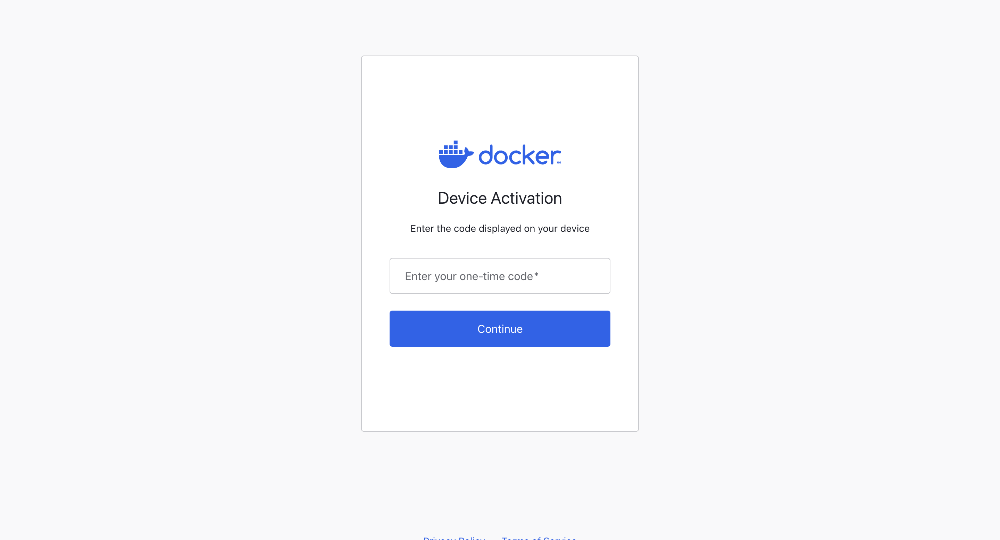
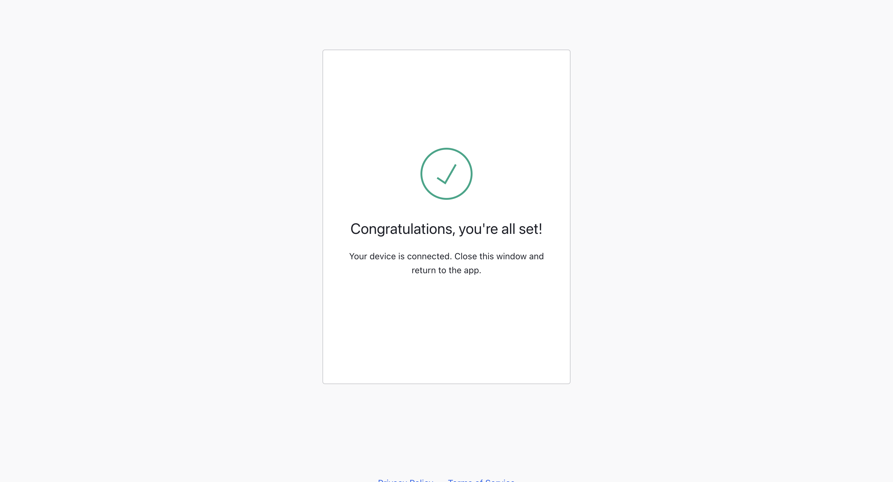

# Python Application
A simple Python application to expose a REST endpoint.

### Build the App
Build the application and push to the Docker Container Registry

```
docker build --tag prat1980/python-app:v1 .

[+] Building 11.1s (8/8) FINISHED                                                                                                                                                    docker:desktop-linux
 => [internal] load build definition from Dockerfile                                                                                                                                                 0.1s
 => => transferring dockerfile: 128B                                                                                                                                                                 0.0s
 => [internal] load metadata for docker.io/library/python:3.12-alpine                                                                                                                                3.5s
 => [internal] load .dockerignore                                                                                                                                                                    0.0s
 => => transferring context: 2B                                                                                                                                                                      0.0s
 => [1/3] FROM docker.io/library/python:3.12-alpine@sha256:e6dae589c1c05976188fd3bd019afd091445fc533ed2ea29001beddc7368a9c8                                                                          6.7s
 => => resolve docker.io/library/python:3.12-alpine@sha256:e6dae589c1c05976188fd3bd019afd091445fc533ed2ea29001beddc7368a9c8                                                                          0.0s
 => => sha256:70ad141c380e304a6b7b6e838d80aa595964f83ef639d37e83c2375669dab7b4 249B / 249B                                                                                                           0.3s
 => => sha256:59fd86b461b1d10e6236ed55231ff21ac611a27cf7c9adbdf6e8615e004f665d 13.92MB / 13.92MB                                                                                                     2.6s
 => => sha256:d2521f7ab0b815cf80ad40aa1f09cbb45d2e6b624a2b663f3fe12637e9387bbc 415.57kB / 415.57kB                                                                                                   1.5s
 => => sha256:d3531b7a4f217bdc3426c57bcff84c170f086f456a39689d4a615c6d026c4be0 4.19MB / 4.19MB                                                                                                       4.3s
 => => extracting sha256:d3531b7a4f217bdc3426c57bcff84c170f086f456a39689d4a615c6d026c4be0                                                                                                            0.5s
 => => extracting sha256:d2521f7ab0b815cf80ad40aa1f09cbb45d2e6b624a2b663f3fe12637e9387bbc                                                                                                            0.5s
 => => extracting sha256:59fd86b461b1d10e6236ed55231ff21ac611a27cf7c9adbdf6e8615e004f665d                                                                                                            1.3s
 => => extracting sha256:70ad141c380e304a6b7b6e838d80aa595964f83ef639d37e83c2375669dab7b4                                                                                                            0.0s
 => [internal] load build context                                                                                                                                                                    0.0s
 => => transferring context: 675B                                                                                                                                                                    0.0s
 => [2/3] WORKDIR /app                                                                                                                                                                               0.3s
 => [3/3] COPY app.py .                                                                                                                                                                              0.1s
 => exporting to image                                                                                                                                                                               0.1s
 => => exporting layers                                                                                                                                                                              0.0s
 => => exporting manifest sha256:69c0c9ead174adcea980d33c4d58b2fa709a21153e459b3de9c6fdceeb617049                                                                                                    0.0s
 => => exporting config sha256:fed304ab8918de910c51542a6ed075ef4854986f3bf200d70773414e27db17aa                                                                                                      0.0s
 => => exporting attestation manifest sha256:4a8188df28e8441593b20be623cc458724fab075b21d0d985115439f87d451f0                                                                                        0.0s
 => => exporting manifest list sha256:d266c10a234dff8f4ed6d51c4cc4bfa5f9a3c4d905f33c2aed5fe8ccfcb04844                                                                                               0.0s
 => => naming to docker.io/prat1980/python-app:v1                                                                                                                                                    0.0s
 => => unpacking to docker.io/prat1980/python-app:v1                                                                                                                                                 0.0s

View build details: docker-desktop://dashboard/build/desktop-linux/desktop-linux/hy9b16jvbyrxs082dlrxhkppl
```
### Check the image locally
```
docker images

IMAGE                   ID             DISK USAGE   CONTENT SIZE   EXTRA
prat1980/python-app:v1  d266c10a234d       78.9MB         18.5MB
```

### Login to Docker Container Registry
```
docker login

USING WEB-BASED LOGIN

i Info → To sign in with credentials on the command line, use 'docker login -u <username>'
         

Your one-time device confirmation code is: NNVZ-ZRXB
Press ENTER to open your browser or submit your device code here: https://login.docker.com/activate

Waiting for authentication in the browser…
Login Succeeded
```





### Push to Docker Container Registry
```
docker push prat1980/python-app:v1                       
The push refers to repository [docker.io/prat1980/python-app]
f4a4b4fb54f7: Pushed 
8d765d24862b: Pushed 
d3531b7a4f21: Pushed 
d2521f7ab0b8: Pushed 
59fd86b461b1: Pushed 
70ad141c380e: Pushed 
7df94feee8ed: Pushed 
v1: digest: sha256:d266c10a234dff8f4ed6d51c4cc4bfa5f9a3c4d905f33c2aed5fe8ccfcb04844 size: 856
```